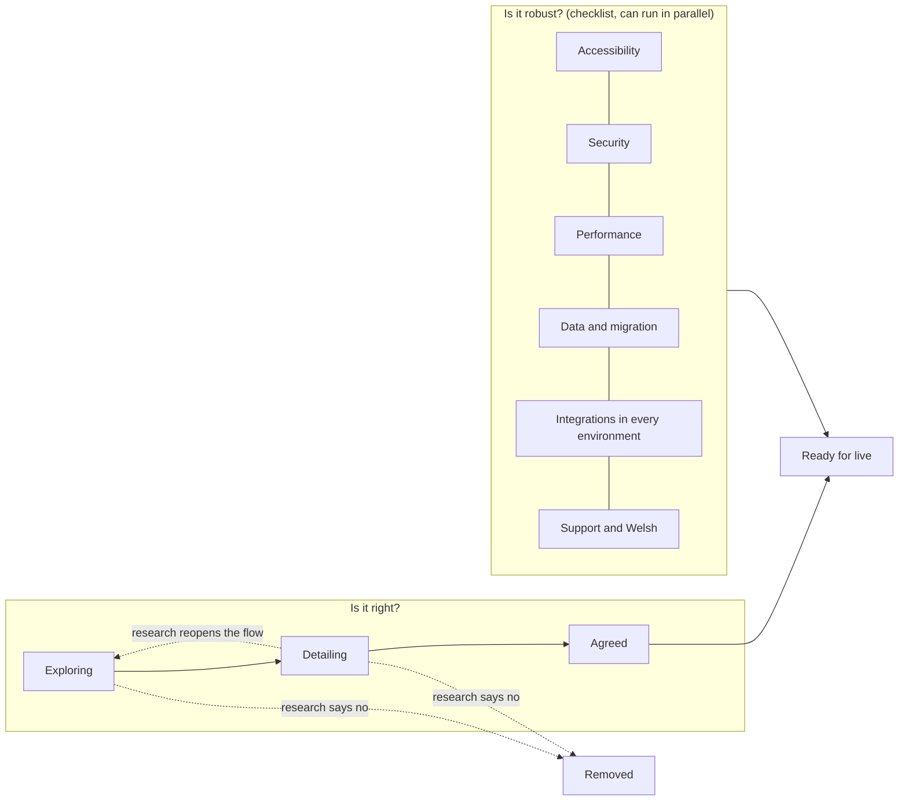
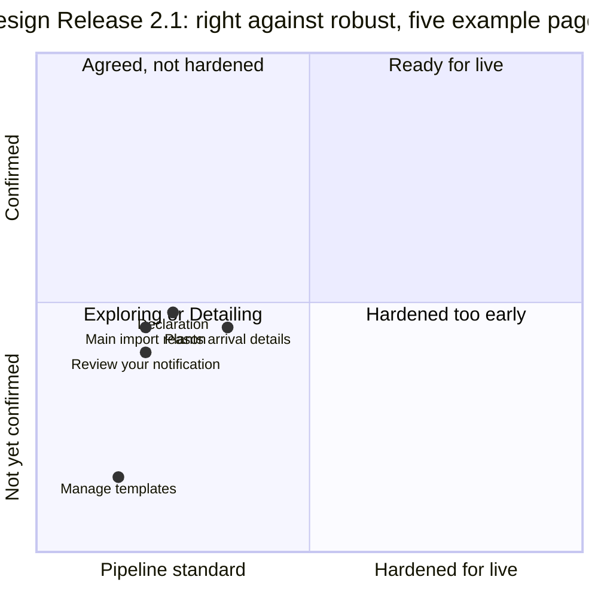

# How mature is it? Naming what the requirements pipeline builds

Thinking paper for Sam. Written 12 October 2026. Nothing here is agreed or built.

Labels used throughout:

- **Recommendation**: what this paper suggests.
- **Option**: a credible alternative, not chosen.
- **Team decides**: a call this paper can't make for the team.
- **Unsure**: the paper's evidence is thin.

---

## Summary

**The problem is a missing word, not a missing process.**
"Done" in the pipeline means "built, tested, in the spec". People hear "agreed" or "ready for live".

**Decided (Sam, 12 October): one level per page, shown on that page, like a GDS phase banner.**

Nothing is more granular than a page.
Controls, fields, content changes and cross-page areas do not get levels.

**Recommendation: give every page a maturity level, shown on the page.**

Four levels, in plain English, that say what is promised:

| Level | One-line promise |
|---|---|
| **Exploring** | Built so we can learn. It might be wrong, and it might be removed. |
| **Detailing** | We're keeping the idea and its flow. We're working out the detail. |
| **Agreed** | Users and the business have confirmed it. Changes need a reason. |
| **Ready for live** | Agreed, and hardened for live: accessible, secure, fast enough, supportable. |

Plus one outcome that counts as success: **Removed**. We learned it was wrong cheaply.

**The unit is the page.** Not the project, theme, row, control or cross-page area.

**Roll-up rule: a page's level is its least mature part.**
One Exploring control makes the whole page Exploring.

**Trade-off for a page that is near-final apart from one experimental part:**

| Option | What it means |
|---|---|
| Show the lower level | The page shows Exploring. Nothing else to build, but the settled parts look less settled than they are |
| Split the experiment off | Put it behind a flag or on a separate page. The rest of the page can move up |

Splitting costs a flag or a new page. Showing the lower level costs honesty about the rest. The team decides (section 10).

**Pages the release does not change keep the level they already have.**

**Two questions sit under the label.** Is it right? Is it robust? The label is the headline; the two checks are the evidence.

**Disciplines own the promotions.** User research, design, content and BA move things up the ladder. The pipeline never promotes anything. It only builds.

**Don't reuse alpha and beta.** GOV.UK's phase banner is service-level by design, and the animals service already shows "Alpha".

**Where it shows:** a record per page in `openspec/`, a target on each backlog row, a level on each review card, a tag on each page in non-live environments, and a Jira label.

**Applied to Design Release 2.1:** 36 pages change. 25 are Exploring and 11 are Detailing.
Pages in the templates, the opening run order, the review restructure and the type question are Exploring, because their flow could still change.
Pages with only content changes are Detailing.
Section 9 has the table, page by page.

**Decided on 12 October: the second level is called Detailing, not Shaping.** See section 4.

---

## 1. Why the confusion happens

Three different things get called "done":

| What someone says | What they mean | Who usually means it |
|---|---|---|
| "The increment is done" | Built, tests pass, spec updated, PR open | Engineers, the pipeline |
| "That's done" | We've decided this is what we want | PO, BA, stakeholders |
| "It's done" | Users can rely on it in live | Everyone outside the team |

The pipeline makes the first happen fast. So the first arrives before the other two have started.

People who see a built, working page assume the other two have happened. That is reasonable: in the usual model, they would have.

So the fix is to say, every time something is shown, which of the three it has reached.

---

## 2. The unit of maturity

**Decided (Sam, 12 October): the page.** One level per page, shown on the page like a GDS phase banner.

Nothing is more granular than a page. A page is what a user, BA or designer recognises ("the Origin page").

| Unit | For | Against | Verdict |
|---|---|---|---|
| Project or service | GOV.UK already does this (the phase banner) | Hides the spread. Design Release 2.1 alone spans several levels | Keep the service phase as it is. Don't use it for this |
| Theme | Matches how things are built and merged | A theme is a build unit drawn by code boundaries, not by confidence. Overview and review mixes new wording with a restructured review page | No |
| Backlog row | Fine-grained, already has status | Rows are temporary. Once merged, nobody looks at them | No, but a row says what level it builds its pages to (section 5) |
| Cross-page area or capability | Matches how `openspec/` groups scenarios | A level has to be shown somewhere. An area has no page to show it on | No. Areas are evidence for a page's level, not a unit |
| **Page** | Stable. Visible. It is where the level is shown | A page can hold parts at different maturity | **Yes**, with the roll-up rule below |
| Control, field, content change, requirement or scenario | Most precise | Too many to communicate (974 scenarios). No place to show a level on a control | No |

### The roll-up rule

**A page's level is its least mature part.**
One Exploring control makes the whole page Exploring.

The INS home shows the effect:

- "Create new" and "Use template" buttons: simple, but built to serve templates.
- Summary counts and drill-downs: not built, "really early days".

The page takes the lower of the two.

### A page that is near-final apart from one experimental part

| | Show the lower level | Split the experiment off |
|---|---|---|
| **How** | The whole page shows the lower level | Put the experiment behind a flag, or on a separate page |
| **For** | No extra work. Nothing hidden | The rest of the page can move up |
| **Against** | Settled parts look less settled than they are | Costs a flag or a new page. A flag is code to remove later |

**Team decides:** which to use, page by page.

### Pages the release does not change

They keep whatever level they already have.
A release only sets a level on the pages it touches.

---

## 3. Separate the questions people conflate

Three questions. The pipeline answers only the first.

| Question | Plain words | Evidence | Who answers it |
|---|---|---|---|
| **Built?** | Does it work end to end in the real stack? | Increment landed, unit, fit and E2E tests, spec and coverage | Engineers and the pipeline |
| **Right?** | Is it what users and the business need? | Research sessions, business review verdicts, content sign-off, BA ratifying the spec | UR, design, content, BA, PO |
| **Robust?** | Can people rely on it in live? | Accessibility audit, security review, performance, data migration, integrations live in every environment, support runbook, Welsh | Engineers, architects, accessibility and security specialists, ops |

Any mix can happen:

| Built | Right | Robust | Example page |
|---|---|---|---|
| Yes | Not yet known | Pipeline standard | Manage templates |
| Yes | Yes | No | A page whose lists come from MDM: the data is authoritative, but MDM isn't configured in every environment yet |
| No | Partly known | No | The INS home's summary counts, which are not built |
| Yes | Wrong | Pipeline standard | Any page research rejects. Correct outcome: Removed |

### Is a 2D grid clearer than a ladder?

**For engineers and the gates, yes.** Right and robust are separate work, by separate people, and can happen in parallel.

**For everyone else, no.** A stakeholder wants one word.

**Recommendation: one ladder for the headline, two checklists underneath.**

- The first three levels climb the "right?" axis.
- Ready for live needs both axes complete.
- Robust work can start at any level. Its checklist shows progress, but it doesn't change the headline until the thing is also Agreed.

### What "pipeline standard" means

Every built increment, at any level, already has:

- unit, fit and E2E tests, in the real Docker stack;
- an OpenSpec capability with coverage links;
- code review, lint and the SonarCloud gate;
- the automated accessibility and security checks in the tests repo;
- GOV.UK Frontend components only.

**This is the honest pitch.** It's higher than an alpha prototype, which GOV.UK says is "not production quality code". Exploring is a low commitment, not low quality.

It is not a full accessibility audit, a pen test, a performance proof or a data migration plan. Those are the robust checklist.

---

## 4. The levels and their names

### Option A: GOV.UK phase words per feature (Discovery, Alpha, Beta, Live)

| For | Against |
|---|---|
| Everyone on a GDS team knows them | The phase banner is service-level by design. The Design System says users "should understand it as a service-level message" |
| | The animals service already shows an "Alpha" banner. "A beta page in an alpha service" confuses everyone |
| | Beta means real users. Live means a passed assessment. Both carry governance this paper doesn't intend |
| | Discovery means research without building, which is the opposite of build to learn |

**Not recommended.**

### Option B: Sam's working words (Ideation, Staging, Ready for live)

| For | Against |
|---|---|
| Short, already in Sam's head | "Staging" is an environment name to every engineer. "It's in staging" will be heard as "it's deployed to a test environment" |
| | Only three levels. Nothing separates "keep the idea and flow" from "the detail is confirmed", which is where most argument happens |
| | "Ideation" sounds unbuilt. These things are built |

**Not recommended as is.** "Ready for live" is kept.

### Option C: confidence words (Unconfirmed, Reviewed, Validated, Assured)

| For | Against |
|---|---|
| Neutral, not GDS-loaded | Abstract. "Validated" means different things to UR, BA and test |
| | Doesn't say what the reader may rely on |

**Not recommended.**

### Option D (recommended): plain promise words

**Exploring, Detailing, Agreed, Ready for live**, plus the outcome **Removed**.

Why:

- Each word says what you can rely on, which is the question a stakeholder is really asking.
- No collision with GOV.UK phases, environments or Jira statuses.
- Plain English. No metaphor to explain.
- "Removed" makes binning a normal outcome, not a failure.

**Decided (Sam, 12 October): the second level is "Detailing", not "Shaping".** Why:

- It says what is settled and what isn't. The idea and its flow are kept. The detail is being worked out.
- It hands the work to the disciplines. Working out wording, layout, field rules, edge cases and error messages is what BAs, content designers and interaction designers do.
- It overlaps less with Exploring. "Shaping" sounds like changing the flow, which is Exploring's job.

**Team decides:** the other words. "Agreed" is the weakest: it risks "built means agreed" in reverse. "Confirmed" is the alternative.

### What each level means

| | Exploring | Detailing | Agreed | Ready for live |
|---|---|---|---|---|
| **Means** | Built to learn. Tactile, real stack, real data shape. The flow or overall shape could still change | The idea and its broad flow are kept. The detail is still being worked out: wording, layout, field rules, edge cases, error messages | Users and the business have confirmed the detail. The spec is ratified | Agreed, and hardened for live |
| **Promises** | It works end to end at pipeline standard. It's in the spec | The need is real and the flow has held up in research. We'll build on it, not start again | This is the behaviour we intend to ship | People can rely on it. It meets the Service Standard |
| **Does NOT promise** | That it's right, that it will stay, or that its data will be kept | That the detail is settled. Wording, layout and rules will still change. It does not promise the flow can never change, only that research has not asked us to change it | That it's accessible, secure or performant beyond pipeline standard | That it won't change. Live services iterate |
| **Who owns it** | PO, with UR and design | BAs, content designers and interaction designers, who work out the detail | BA and PO | Tech lead and architect, with the PO |
| **Data** | Disposable. Own collection or fields, droppable | Kept. Changes need a migration from here | Kept. Migration plan for any change | Migrated, backed up, retention agreed |
| **Change caution** | Anyone, through the pipeline, no sign-off. Delete freely | Detail changes go to the discipline that owns them. A change to the flow is a PO ruling (like Sam's `ruling-sam-*.md` files) and sends it back to Exploring | Change needs a reason, re-review and BA sign-off on the spec change | Normal change control. Regression proof, comms, assessment if significant |
| **Shown in prod?** | No. Off in prod | No, unless the team chooses to research in prod | Yes, if the service is in beta | Yes |

**The test for Detailing:** could the flow or overall shape still change after research? If yes, it is Exploring.

Detailing is where the work is handed to the disciplines. The flow is settled enough that they can get on with the detail.

### Who promotes, and on what evidence

**The pipeline never promotes anything.** It only builds.

| Move | Who decides | Evidence needed |
|---|---|---|
| (nothing) to Exploring | PO, or Sam as tech lead, ruling that it's worth building to learn | A backlog row with a "why", and an Exploring target |
| Exploring to Detailing | PO, with UR and design | Research, or a business review, that confirms the flow and overall shape, with "Right" verdicts on the direction. Written down. Then the detail is handed to BA, content and interaction design |
| Detailing to Agreed | BA and PO, with design and content | Research on the detail. Content designer signs off the wording. BA ratifies the spec for the page (the scenarios read as the business rules). No open business questions in the spec audit |
| Agreed to Ready for live | Tech lead and architect, with the PO | The robust checklist: accessibility audit (WCAG 2.2 AA, manual and assistive tech), security review, performance proven (the k6 suite), data and migration plan, integrations configured in every environment, support runbook, Welsh translated by a translator |
| Any level to Removed | PO | What we learned, one line. The code and data are removed |
| Any level down | Anyone with evidence | Research or review that reopens it. Going down is normal. If the flow reopens, Detailing goes back to Exploring |

**Unsure:** which DEFRA assurance bodies need to see the robust checklist (accessibility audit, IT health check). That's for the delivery manager to confirm.

---

## 5. Where the marker lives

The level must be visible wherever people already look. One source of truth, many views.

### The source of truth: `openspec/`

**Recommendation:** a maturity record per page, beside coverage.

- One `openspec/maturity.json` keyed by service and route. Or one file per page.
- Fields: `level`, `owner`, `since`, `evidence` (links: research write-ups, business review verdicts, content sign-off, audit reports), and the robust checklist with each item's state.
- Not in `spec.md`. The spec is intended behaviour. Maturity is a claim about confidence in it, like coverage.
- A `tim spec maturity` command reports it, and lint checks it:
  - every page has a level;
  - a page's level is no higher than its least mature part;
  - a level above Exploring has evidence;
  - Ready for live has every robust item ticked.

**Option:** a column in `openspec/coverage/AREAS.md`. Simpler, but no room for evidence, and it groups by area, not page.

### Backlog rows

**Recommendation:** an optional `maturityTarget` on each row: the level the row builds to.

- DISTIL sets a default from the source:
  - a design release prototype screen: Exploring;
  - a content designer's signed-off wording: Detailing;
  - a ruling can set any level.
- The row does not set a page's level. Only the promotion does.
- A row may touch many pages. Each page takes the lowest target among the rows that change it.
- A row that builds to Exploring may take shortcuts a Detailing row may not, such as a separate collection, or no Welsh review.

Caveat: a new row field touches the schema, `tim backlog check`, the loop and the briefs, as the coupling table in `SKILL.md` says.

### The review pages

The business review page already asks "Is this the right change?" per card.

- **List the pages each card touches**, each with its current level and the level this change aims for.
- A card is a change, not a page. It carries no level of its own.
- **The verdicts become promotion evidence.** A "Right" from the PO and BA on a Detailing card is half of the case for Agreed.
- **Change the question per level.** For Exploring: "Is this worth exploring further, and is the flow right?" For Detailing: "Is the detail right?" For Agreed: "Is this exactly right?" Asking "is this right?" of an Exploring card invites a specification debate it can't win.

### The running service

**Recommendation:** a tag per page, in non-live environments only.

- Keep the GOV.UK phase banner as it is. It's the service's phase, and it's assessed.
- Below it, on dev, test and perf-test, show a grey `govukTag` and one sentence: "Exploring: this page may change or be removed."
- Text, not colour alone. Use GOV.UK Frontend components only.
- Driven by config: a map from route to level, read from the maturity record at build time.
- Never shown in prod. In prod, Exploring things aren't there at all (below).

**Unsure:** whether a per-page tag will distract research participants. UR decides per round. Turn it off for a session with a config switch.

### Feature flags per environment

Exploring work merges to `main` so it stays cheap to keep up to date. It must not reach live users.

- **Recommendation:** a flag per Exploring page, or per experimental part split off a page. Off in prod by default.
- The animals frontend has no feature flag mechanism today. One would be needed: a config value per flag, and a guard on the route.
- A flag on one part is also the way to split an experiment off a page (section 2).
- Environment config lives in `cdp-app-config`. That's Sam's to change, not the pipeline's.
- A flag is code too. Remove it when its page is promoted or Removed. Lint for flags older than their page's last change.

**Option:** keep Exploring work on branches, never on `main`. Safer for prod, but the branch drifts and the benefit of fast iteration is lost. Design Release 2.1's combined branch showed how much merge work drift costs (34 conflicts in one repo).

### Jira

- A label per level: `maturity-exploring`, `maturity-detailing`, `maturity-agreed`, `maturity-ready-for-live`.
- The epic's description names the target level, so a ticket titled "Templates" isn't read as "templates are coming to live".

### The progress page

Count pages by level, not only rows by status. "Implemented 120 of 160 (75%)" sounds like nearly finished. "12 Exploring, 30 Detailing, 4 Agreed, 0 Ready for live" says what it is.

---

## 6. How the pipeline fits the GDS lifecycle

The pipeline doesn't replace the disciplines. It changes what they work with: a working thing, not a description of one.

### Build to learn is a research and design tool

- GOV.UK alpha says: build "just complex enough to let you test different ideas" and "expect to throw away any code".
- The pipeline does the same, but in the real stack, with real reference data and real persistence.
- That makes research richer. Participants use something that behaves like the service, not a click-through.
- **The animals service still shows an Alpha banner.** By GOV.UK's own rules, throwing work away is expected in this phase. **Unsure:** whether the service has passed an alpha assessment, or is treated as in beta. That changes how much Exploring work should reach shared environments.

### The spec follows the build, and the BA ratifies it

- Today the pipeline writes the spec as it builds, and the spec audit catches up anything missed.
- The BA's role moves from writing the spec first to **ratifying and challenging** it at the Detailing to Agreed gate.
- The audit's "questions for the business" are the hand-off. Design Release 2.1's audit raised 7 (one on commodities, six on templates). Each is a question a BA is best placed to answer.
- That's a real job, and a senior one. Present it that way.

### What each discipline does at each level

| | Exploring | Detailing | Agreed | Ready for live |
|---|---|---|---|---|
| **PO** | Chooses what to explore. Rules on open questions | Decides to keep, change the flow or remove | Accepts the detail | Accepts for live |
| **BA** | Names the business rules at risk. Reads the spec as a list of assumptions | Works out field rules and edge cases. Challenges spec scenarios. Answers the audit's questions | Ratifies the spec | Checks business rules against policy and the PIMS data contract |
| **User researcher** | Tests the riskiest assumption with the built thing | Tests the detail. Feeds back changes | Confirms with a final round, including assistive tech users | Plans research in live |
| **Interaction designer** | Uses it as a prototype. Settles the flow, in the prototype or by asking for increments | Works out layout and interaction detail within the flow | Signs off the pattern | Checks against GOV.UK patterns |
| **Content designer** | Not yet, unless content is the question | Edits wording and error messages in place | Signs off wording. Sends for Welsh | Welsh translated and checked |
| **Engineer** | Builds at pipeline standard. Keeps data disposable | Plans migrations from here | Starts the robust checklist | Completes it |
| **Architect** | Checks Exploring work doesn't touch shared contracts | Reviews the data model | Reviews integrations and data retention | Signs off |

### Answering "specs first" honestly

The request is reasonable. Sometimes specs first is right.

**Specs first is right when:**

- **The rule comes from law or policy.** The pipeline can't learn a regulation by building. The BA has to state it.
- **Data leaves the service.** The GBN-AG message to PIMS, events on the bus, schemas in `trade-imports-schemas`. Another organisation depends on the shape. Sam's own germinal ruling did this: "store in our db for now", and the schema change is a ticket, not an increment.
- **It's expensive to reverse.** Public URLs, identity and sign-in, data other services read.
- **There's nothing yet to react to.** The INS dashboard summary is the example. Sam blocked it: "has not been bounced off anyone". Building it would show designers their own guess back to them. The first need is research on what counts matter, not a build.
- **The question is about users, not the interface.** Discovery-style questions ("do importers think in notifications or consignments?") are answered by interviews, not builds.

**Build first is right when:**

- The question is about flow, layout, wording in context, or how it feels.
- Building it costs less than writing and agreeing the spec.
- Being wrong is cheap: the data is disposable and nothing outside the service depends on it.

**The deal to offer the team:** build first for Exploring, inside the rules above. Nothing is promoted without the disciplines' evidence. Nothing reaches live users while Exploring.

---

## 7. Risks, and how to manage them

| Risk | What it looks like | How to manage it |
|---|---|---|
| **Built means agreed** | A stakeholder sees templates working and plans around it | The tag on every page. The badge on every review card. Level counts on the progress page. Jira labels |
| **Demo read as a commitment** | "Show the minister the dashboard" | Demos name the level out loud, every time. Never demo Exploring work outside the team without the tag |
| **Sunk cost** | "We've built it now, let's keep it" | Removed is a counted, celebrated outcome. Only the PO can promote, and only on research or review evidence. The build effort is never evidence |
| **Data model debt** | The templates Mongo collection lasts longer than the idea | Exploring data lives in its own collection or fields. Nothing Exploring is published on events or to PIMS. Removing it means dropping the collection. From Detailing, every change needs a migration |
| **Accessibility and security debt reaches live** | A custom interaction slips through at pipeline standard | Ready for live is a gate, not a mood. The robust checklist must be complete. Flags keep Exploring work out of prod |
| **Shared code lowered by Exploring work** | A cross-cutting change made for an Exploring feature, such as the backend fetch timeout | **Maturity applies to pages only.** Shared code, config, build and backends are always held to Ready for live review. The engineering review page already ranks these first |
| **Rework cost** | Detailing changes undo a lot of Agreed-adjacent code | Templates shows the answer: build Exploring things as another way through the same pages, not a copy. Sam's ruling on template mode says so |
| **Levels become bureaucracy** | Every change waits on a gate | Exploring and Detailing need no sign-off to build. Gates are only on promotion |
| **The label goes stale** | The record says Detailing, research said Removed months ago | `tim spec maturity` lint. Review the levels at each design release, as a standing agenda item |
| **Discipline pushback continues** | "We still want specs first" | Give them the gates. They hold the power to promote, which is what specs first was really asking for |

---

## 8. How Sam communicates it

### The pitch (one paragraph)

> We build things to learn what's right, not to declare that they are. Everything the pipeline builds starts as **Exploring**: it works, it's tested, and we might throw it away. Research and review move it to **Detailing** once the idea and its flow are kept. From there the BAs, content designers and interaction designers work out the detail, and it becomes **Agreed**. Only design, research, content and the BA can move it up. **Ready for live** means it's also been hardened for live: accessibility, security, performance, data. Every page shows its level in our test environments, and nothing Exploring reaches live users. So when you see something working, the question isn't "did we agree this?". It's "what level is it, and what would move it up?"

### Glossary

| Word | Means |
|---|---|
| Page | The unit of maturity. One level per page, shown on the page |
| Roll-up | A page's level is its least mature part |
| Increment | One small change the pipeline builds and tests. Done means built, not agreed |
| Exploring | Built so we can learn. Might be wrong, might be removed. Not in live |
| Detailing | We're keeping the idea and its flow. The detail is being worked out: wording, layout, field rules, edge cases, error messages |
| Agreed | Users and the business have confirmed the detail. The spec is ratified |
| Ready for live | Agreed, and hardened: accessible, secure, fast enough, supportable, in Welsh |
| Removed | We learned it was wrong, and took it out. A good outcome |
| Pipeline standard | What every built thing has: tests, a spec, code review, GOV.UK components |
| Robust checklist | What Ready for live adds: audits, performance, data migration, live integrations, support, Welsh |
| Promotion | Moving up a level. Needs evidence and the right person |
| Service phase | GOV.UK's alpha, beta or live, for the whole service. Separate from all of the above |

### The picture

The ladder and the parallel checklist are in the diagram in section 3.

A second view, for a release:

Positions are this paper's judgement, not measured.

---

## 9. Applied to Design Release 2.1

**36 pages change. 25 are Exploring and 11 are Detailing.**
No page is Agreed or Ready for live. No page is Not built.

Each page takes the level of its least mature part (the roll-up rule).
Pages the release does not change are not listed. They keep their current level.
"(judgement)" marks a level that comes from an area judged on reading, or from an indirect link.

Path prefixes:
- Animals: `/live-animals`. A notification page is `/live-animals/notifications/{id}/<slug>`.
- Plants: `/high-risk-plants`. A notification page is `/high-risk-plants/notifications/{id}/<slug>`.
- INS: no prefix.

### Animals

| Page | Service | Level | Why |
|---|---|---|---|
| Notification list `/live-animals` | Animals | Exploring | New Templates item in the navigation |
| Origin of the import `.../origin` | Animals | Exploring | Also opens in template mode. Its own changes (country search, hints) are only Detailing |
| What are you importing? `.../commodities` | Animals | Exploring | Moved in the opening run order. Also opens in template mode |
| Main import reason `.../import-reason` | Animals | Exploring | Now asked before commodity details. The new order is not confirmed by research |
| Commodity details `.../consignment-details` | Animals | Exploring | Now follows the reason in the opening run order |
| Identification details `.../commodities/identification` | Animals | Exploring | Chained into the new opening run order |
| Additional details `.../additional-details` | Animals | Exploring | Placed by the new opening run order |
| Roles and addresses `.../addresses` | Animals | Exploring | Now goes straight to the contact address, not the CPH number |
| CPH number `.../cph-number` | Animals | Exploring | Left the opening run. Opens only from Roles and addresses |
| Contact address `.../consignment/contact/select` | Animals | Exploring | Saving it now always opens the review |
| Arrival details `.../port-of-entry` | Animals | Exploring | Also opens in template mode. Its own changes (wording, port labels) are Detailing |
| Transit countries `.../transit-countries` | Animals | Detailing (judgement) | Clearer title, Back link and empty state. Wording only. Its list comes from MDM, which is not hardened |
| Transporters `.../transporters` | Animals | Exploring | Buttons differ when editing a template |
| Upload documents `.../accompanying-documents` | Animals | Exploring (judgement) | Template creation skips it. The page itself is unchanged |
| Overview `/live-animals/notifications/{id}` | Animals | Exploring (judgement) | Return-to-overview flow and the opening run order feed it |
| Review your notification `.../notification-view` | Animals | Exploring | Restructured into numbered sections. Also serves the submitted view and the amend review |
| Declaration `.../declaration` | Animals | Detailing | Smaller checkbox, no status strip. Content only |
| Import notification submitted `.../confirmation` | Animals | Detailing | Wording and HMRC link changes. Content only |
| Manage templates `/live-animals/templates` | Animals | Exploring | New. A proof of concept |
| Enter template name `/live-animals/templates/{id}/name` | Animals | Exploring | New. Part of the templates proof of concept |
| Template page `/live-animals/templates/{id}` | Animals | Exploring | New. Task list while creating, the saved template afterwards |
| Review your template `/live-animals/templates/{id}/notification-view` (path inferred) | Animals | Exploring | New. Part of the templates proof of concept |

### Plants

| Page | Service | Level | Why |
|---|---|---|---|
| Notification list `/high-risk-plants` | Plants | Exploring | New Templates item in the navigation |
| What are you importing? `.../commodity-type` | Plants | Exploring (judgement) | Plants asks the type again after the INS question. Flow for plants undecided |
| Origin `.../origin` | Plants | Detailing | New country box wording. Content only |
| Arrival details `.../arrival-details` | Plants | Detailing | Wording and port labels. Its list comes from MDM, which is not hardened |
| Consignment contact `.../consignment/contact/select` | Plants | Exploring | Continue now opens check your answers, even if unfinished |
| Check your answers `.../notification-view` | Plants | Exploring | The run now ends here, even if unfinished. Also serves the submitted view |
| Overview `/live-animals/notifications/{id}` | Plants | Detailing (judgement) | Return-to-overview behaviour and screen reader regions. Not part of the opening run change |
| Consignor picker `.../consignors/select` | Plants | Detailing (judgement) | Button changes while amending. Content only |
| Declaration `.../declaration` | Plants | Detailing | Smaller checkbox, no status strip. Content only |
| Submitted page `.../confirmation` | Plants | Detailing | Opening it too early now goes to the declaration |

### INS

| Page | Service | Level | Why |
|---|---|---|---|
| INS home `/` | INS | Exploring (judgement) | Create new and Use template exist to serve templates. Summary counts are not built |
| What are you importing? `/notification-type` | INS | Exploring (judgement) | What happens for germinal, before its set exists, is an open flow question |
| Address book `/address-book` | INS | Detailing | New title pattern. Its list comes from MDM, which is not hardened |
| Add address `/address-book/add` | INS | Detailing | New title pattern and the full country list |

### Count by level

| Level | Pages |
|---|---|
| Exploring | 25 |
| Detailing | 11 |
| Agreed | 0 |
| Ready for live | 0 |
| Not built | 0 |
| **Total** | **36** |

### What this changes

The roll-up rule moves several pages down.

- The animals Origin, Arrival details and the commodity pages carry Detailing changes. Template mode or the new run order makes them Exploring.
- The INS home is Exploring because its summary part is not built. The summary is the lowest part, but it is not on the page yet.
- No page is only MDM lists. A list never sets a level alone, because every page that uses one also has wording or flow changes.

Each of these is a case for the trade-off in section 2.
Splitting template mode off behind a flag would let Origin and Arrival details show Detailing.

### Why: findings behind the levels

These are the reasons, kept from the earlier area review. They give no level of their own.

| Finding | What it says |
|---|---|
| Content changes | Wording is what Detailing works out. Copied from the design release, which content designers wrote. Sam thinks it is close to live. Needs content designer sign-off in context, and a translator's Welsh |
| Origin country search | Clear improvement on a long drop-down. The flow is the same; only the control's detail is open. **Unsure:** whether the search pattern has had an assistive technology check beyond the automated one |
| INS home controls | Simple, ruled to go ahead. But they exist to serve templates and the type question, so the flow can change if those do. Judged on reading |
| "What are you importing?" type question | The need is clear and ruled. What happens for germinal, before its set exists, is an open question about the flow. Judged on reading |
| INS dashboard summary | Not built. Blocked by Sam's ruling: "has not been bounced off anyone". A specs-first case: research before any build |
| Templates | A proof of concept. Six open business questions from the audit. Research may change it a lot or remove it. Its Mongo collection (`NotificationTemplate`) is its own, so removing it is cheap. Keep it that way |
| Opening run order | The order is the flow, and research could still change it. A review gate (inc-001) is still open. The "Add another commodity" landing question is unanswered. No research round has confirmed the walk yet |
| Review page restructure | The page structure could still change after research. Review gate (inc-101) is still open, and no research has confirmed it. Likely to be refined, not removed |
| Reference lists from MDM | The data's authority is MDM and the ordering is ruled. Not robust: MDM isn't configured in perf-test, ext-test or prod, its data has duplicates and typos, and port of exit has no approved-for-animals flag |
| Germinal products set | Not a page in this table. Its PIMS schema change is a separate ticket and its data shape is undecided |

Each page moves to Detailing once research confirms the flow of its Exploring parts.

### Not a page

The backend fetch timeout and retry is not a maturity question. It is shared code, held to Ready for live review, and first on the engineering review page.

### Unsure

- **Templates item in the navigation.** It appears on every page of every frontend. This table counts only the two list pages. Counting it everywhere would make every page Exploring.
- **Pages sharing a route.** Review, the submitted view and the amend review share `.../notification-view`, so they share one row per service.
- **Levels marked "(judgement)"** come from areas judged on reading, or from an indirect link to an area.
- **Template review path** is inferred from the code, not from the cards.

**What this shows:** one release spans several levels, and one case that shouldn't be built yet. That is why a single "Design Release 2.1 is done" misleads.

---

## 10. For the team to decide

1. **The words.** Decided for the second level: **Detailing** (Sam, 12 October). Still open: Exploring, Agreed, Ready for live, Removed. Or "Confirmed" for "Agreed".
2. **Show the lower level, or split the experiment off** (behind a flag, or onto a separate page) when one page holds an experimental part.
3. **Who signs off each promotion** in this team, by name or role. The table in section 4 is a starting point.
4. **Whether Exploring work merges to `main` behind a flag**, or stays on branches.
5. **What the service phase really is.** The banner says Alpha. If the service is treated as beta, Exploring work needs tighter flags.
6. **Whether research participants see the per-page tag.**
7. **Which DEFRA assurance steps** belong on the robust checklist.

## Next steps, if the team likes it

1. Agree the words and the gate owners, in one session with the disciplines.
2. Classify every current page. Pages a release does not change keep their level. Default anything built from a design release to Exploring until someone promotes it with evidence. Section 9 is a start.
3. Add the maturity record and `tim spec maturity` to `openspec/`.
4. Badge the business review page and change its question per level.
5. Add the per-page tag in non-live environments.
6. Add `maturityTarget` to the backlog schema, with DISTIL's defaults.
7. Add flags only when the first Exploring page is about to reach `main`.

## Sources

- GOV.UK Service Manual, [how the alpha phase works](https://www.gov.uk/service-manual/agile-delivery/how-the-alpha-phase-works)
- GOV.UK Design System, [phase banner](https://design-system.service.gov.uk/components/phase-banner/)
- `.claude/skills/requirements-pipeline/` (`SKILL.md`, `references/backlog.schema.json`)
- `openspec/config.yaml`, `docs/reference/openspec.md`
- `workareas/shared/design-release-2-1/`: `HANDOVER-REVIEW.md`, `themes/HOW-TO-BUILD.md`, `combined/README.md`, `combined/openspec-audit.md`, `sources/ruling-sam-2026-10-09.md`, `sources/ruling-sam-2026-10-09-templates.md`, `deferred.md`, `theme-summaries.json`
- `repos/trade-imports-animals-frontend/src/server/app/shared/layout.njk` and `copy.en.js` (the Alpha phase banner)
