# How navigation works through the live animals journey

One situation per section: what happens on `main` today, what used to happen, and what the design snagging theme will change. The same content, as tabs, is on the Navigation tab of the snags page: https://claude.ai/artifact/GLHDRhbGkXYnu41ZiDTdmR

Read from `origin/main` of the animals frontend (d1dc8d74) and plants frontend (1abc179), the journey foundation merge (6760aee8) and the commit before it, and the Design Release 2.1 prototype's `app/routes.js`, 20 October 2026. Code paths are under `repos/trade-imports-animals-frontend/src/server/app/sets/live-animals/journeys/linear/` unless they start with `shared/`, `flow/` or `engine/` (under `src/server/app/`) or `plants`.

## Summary

| | |
|---|---|
| The Back link fix | **Not built.** One row in the design snagging theme, still to do. |
| The amend fix | **Built and merged** to `main` in both frontends (animals #420, plants #112). |
| What the Back link fix changes | Back on five opening-run pages opens the page before it instead of Overview, so the run carries on. |
| Why it matters | Showing Overview ends the opening run for good. Today one Back click mid-run means every later Save and continue returns to Overview. That is most likely what the tester on the journey foundation ticket hit. |
| Unchanged | A page opened from its Overview task still returns to Overview on Save and continue, as the prototype does. |

Key: a solid arrow is a button or link; a dashed arrow is the Back link. A node styled `differs` is where `main` differs from the prototype.

## When you create a new notification

Start a new notification on the dashboard and each Save and continue opens the next page, all the way to the review. This is the opening run. Pages that do not apply are skipped.

On main today, part 1:

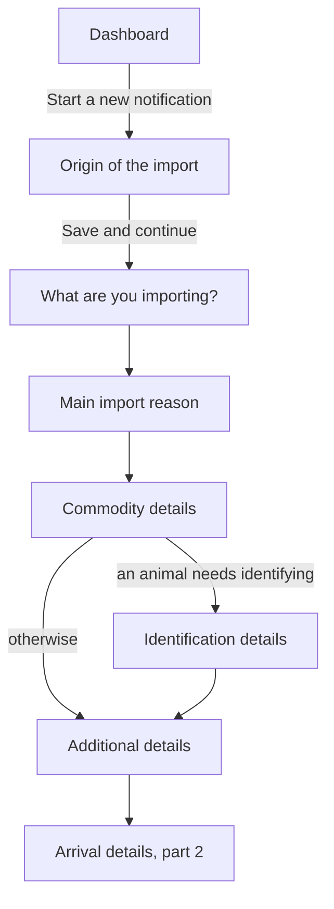

On main today, part 2:

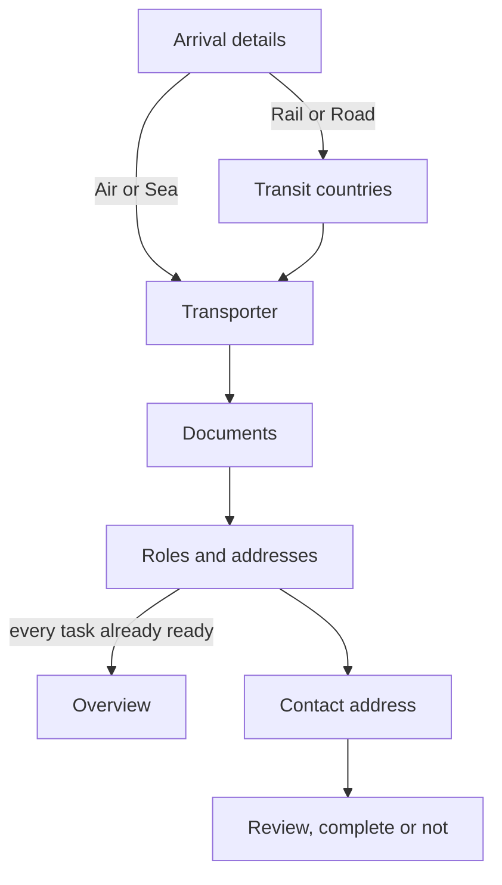

Before 13 October, the order that changed:

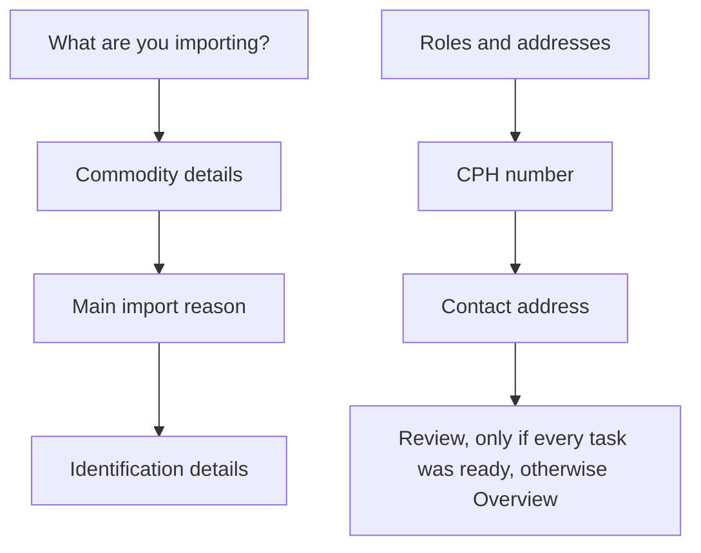

| Step | What happens | Status | Code |
|---|---|---|---|
| Start a new notification | Creates it and opens Origin of the import. The opening run starts, for this notification in this browser session only | On main | `features/dashboard/controller.js:121-125` |
| Save and continue on a run page | Opens the next page of the run that applies | On main | `flow/run.js:36-81` |
| Identification details, Transit countries | Skipped when they do not apply | On main | `flow/run.js` `flowPageTarget` |
| Roles and addresses | Goes to Overview instead if every task is already ready | On main | `flow/run.js:73-75` |
| Review | Shown complete or not; it names what is still missing. Showing it ends the run | On main | `check-answers/controller.js:181` |
| Order before 13 October | Commodity details came before Main import reason, the CPH number page was a run step, and the run ended on Overview unless every task was ready | Before | `flow/run.js` at 6760aee8^ |
| Prototype | Same order as main now, plus a gross weight page for germinals | Prototype | prototype `app/routes.js:1534-1577` |

## When you press Back while creating a notification

Today, Back in the middle of the run opens Overview, and showing Overview ends the run for good, so every later Save and continue also returns to Overview. Design snagging makes Back open the page before it, as the prototype does. Not built yet.

On main today:

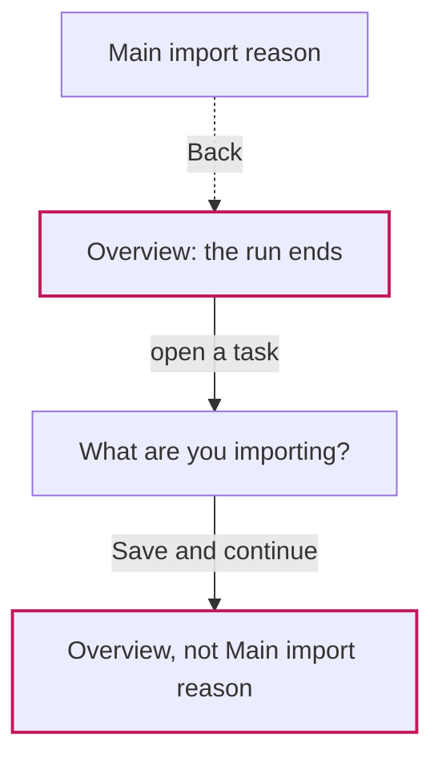

Planned by design snagging, not built:

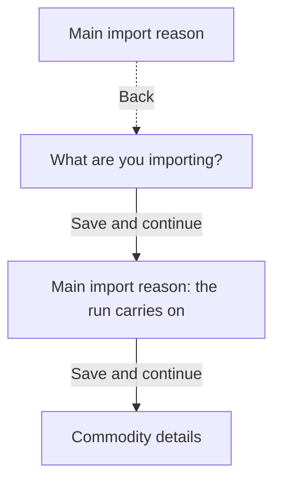

Planned: Back from the commodity pages:

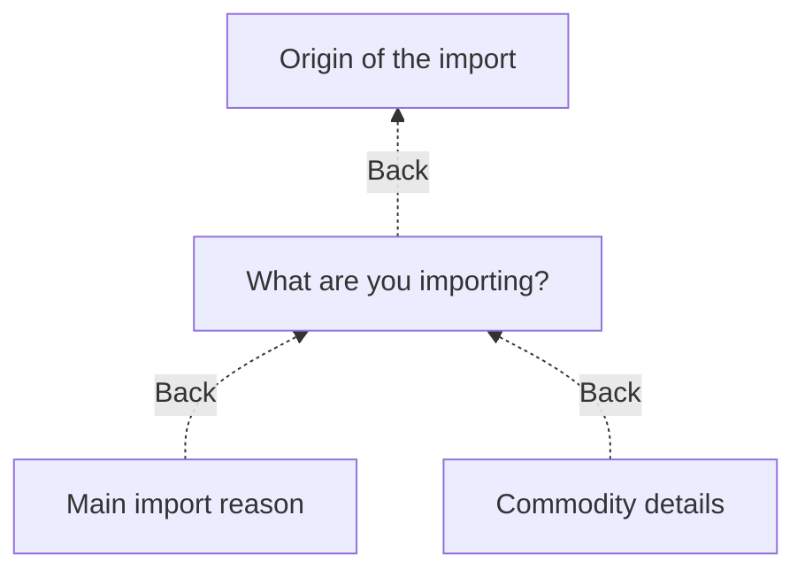

Planned: Back from Additional details and Transit countries:

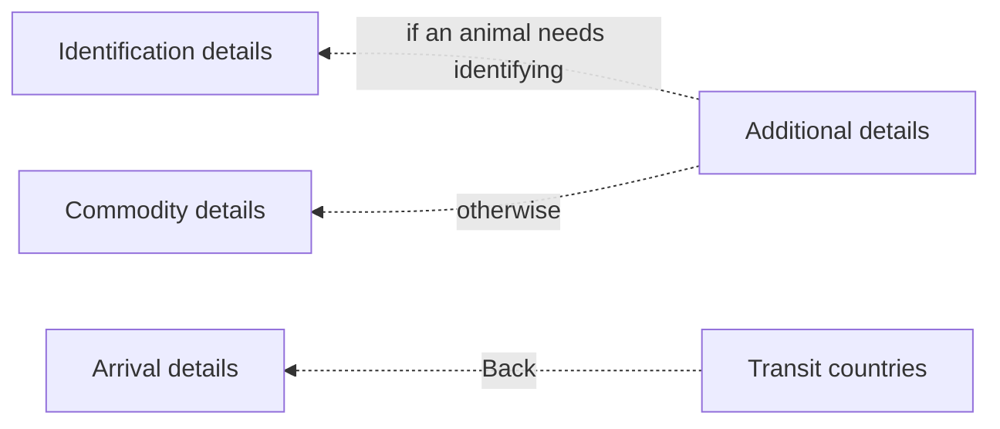

Still Back to Overview after the fix:

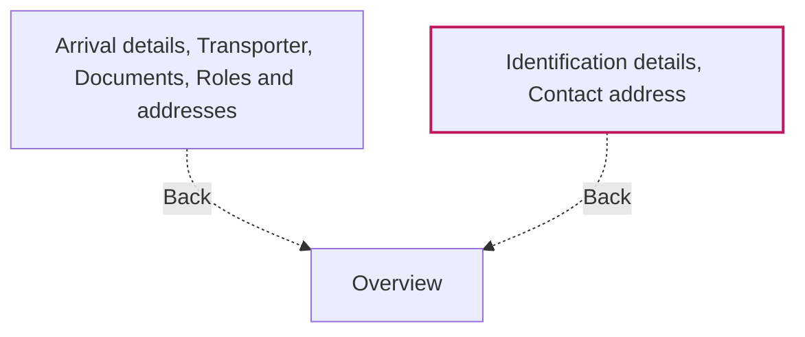

| Page | Back today | Back once design snagging lands | Prototype | Code |
|---|---|---|---|---|
| Origin of the import | Dashboard if nothing is saved, otherwise Overview | No change | Dashboard or notification list | `origin/controller.js:44-47` |
| What are you importing? | Overview | **Planned:** Origin of the import | Origin of the import | `commodities/search/search.controller.js:38` |
| Main import reason | Overview | **Planned:** What are you importing? | What are you importing? | `import-reason/controller.js:61` |
| Commodity details | Overview | **Planned:** What are you importing? It skips the reason, as the spec says | What are you importing? | `consignment-details.controller.js:50` |
| Identification details | Overview | No change: the spec keeps Overview | **Differs:** Commodity details | `animal-identification.controller.js:58` |
| Additional details | Overview | **Planned:** Identification details if an animal needs identifying, else Commodity details | Same as planned | `additional-details/controller.js:41` |
| Arrival details | Overview | No change | Overview | `port-of-entry.controller.js:61` |
| Transit countries | Overview | **Planned:** Arrival details | Same as planned | `transit-countries.controller.js:61` |
| Transporter, Documents, Roles and addresses | Overview | No change | Overview | `transporters.controller.js:58`, `documents/view-model/render.js:41`, `addresses/controller.js:89-93` |
| Contact address | Overview | No change: the spec keeps Overview | **Differs:** Roles and addresses | `contact/controller.js:83` |

- The run ends whenever Overview or the review is shown (`features/hub/controller.js:114`). It never restarts for that notification.
- The planned Back target comes from the run's own page list and the answers, not a marker on the link, as Sam ruled on 9 October.
- A validation error shows the same page again with the same Back link.

## When you continue a draft from the dashboard

A draft opens on Overview. There is no opening run, so every task returns to Overview when saved.

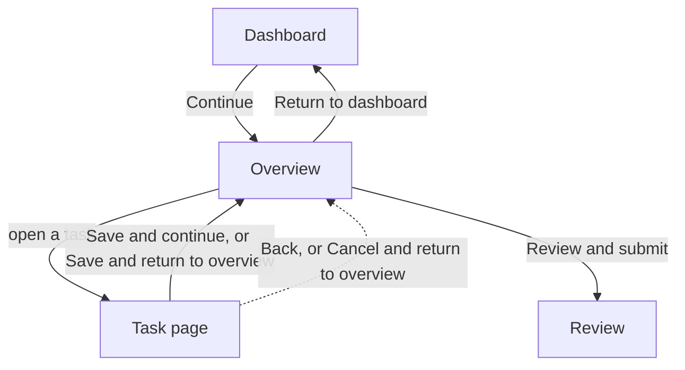

| Step | What happens | Code |
|---|---|---|
| Continue on the dashboard | Opens Overview | `dashboard/view-model/row/actions.js:43-48` |
| A draft whose run has ended, or from an earlier session, another browser or another person | Same: Overview, no run | `flow/run-state.js`, `flow/entry-guard.js:48-60` |
| Overview | Has no Back link, only Return to dashboard | `features/hub/controller.js:129` |

## When you work on a task from Overview

A task opened from Overview returns to Overview when saved. Only Roles and addresses has a second page, the CPH number, which returns to it.

Most tasks, for example Arrival details:

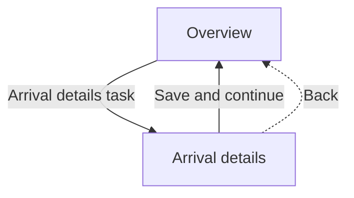

Roles and addresses, with the CPH number:

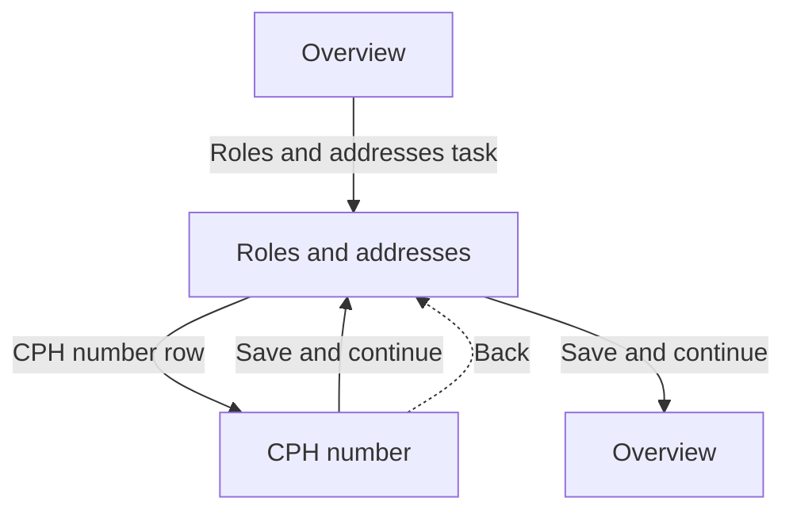

Before 13 October, saves went on through the section:

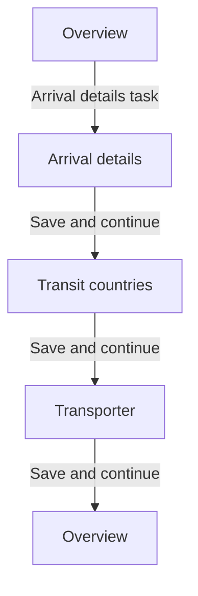

| Step | What happens | Status | Code |
|---|---|---|---|
| Save and continue on a task page | Overview, unless the same task has another page | On main | `shared/kit.js:144-149`, `flow/navigation.js:55-60` |
| Save and return to overview | Overview, saving what is there even if incomplete | On main | `shared/kit.js:117-120` |
| CPH number from its row | Saves back to Roles and addresses; Back goes there too | On main | `cph-number/controller.js:31-34, 48, 91` |
| Before 13 October | Save and continue went on to the next page of the same section | Before | `flow/navigation.js` `nextInSection` at 6760aee8^ |
| Prototype | Same as main now | Prototype | prototype `app/routes.js:1632-1646` |
| Question for the designers | Should Save and continue from a task go on to the next unfinished task instead? | Open | `snagging/eudpa-691/save-and-status.md` |

## When you change an answer from the review

A Change link opens the page; saving returns to the review. Back from that page opens Overview on `main`, but the page before it in the prototype.

On main today:

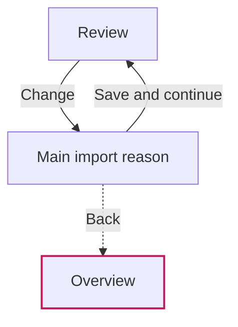

Prototype, and planned in a later theme (deferred):

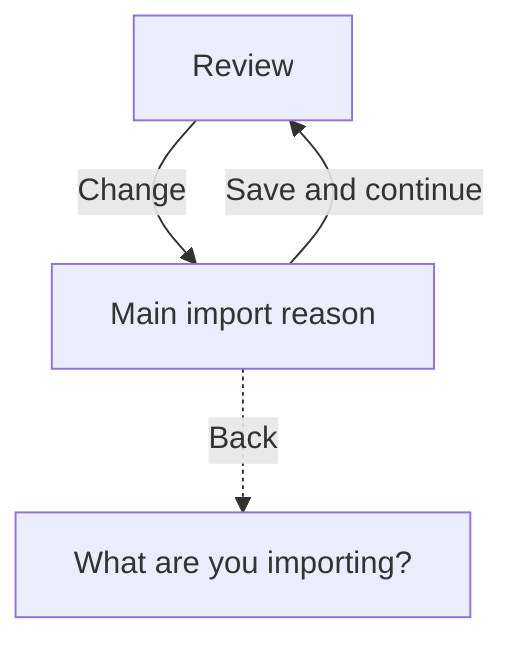

| Step | What happens | Status | Code |
|---|---|---|---|
| Change on the review | Opens the page with a change flag on its address | On main | `check-answers/view-model/rows/change-link.js:12-15` |
| Save and continue there | Back to the review | On main | `shared/kit.js:127-131` |
| Back there | Overview. Roles and addresses on a draft goes back to the review | Differs | `addresses/controller.js:89-93` |
| Back, as planned | The page before it. Templates theme, deferred | Later theme | templates theme, "Back from a page opened by a review Change link" |
| In an amendment | Save and return goes to the review; Back keeps its usual target | On main | `shared/amend-form-actions.js:25-35` |

## When you submit a notification

Review and submit opens the review, which shows what is missing. Continue opens the declaration, and Submit confirms it.

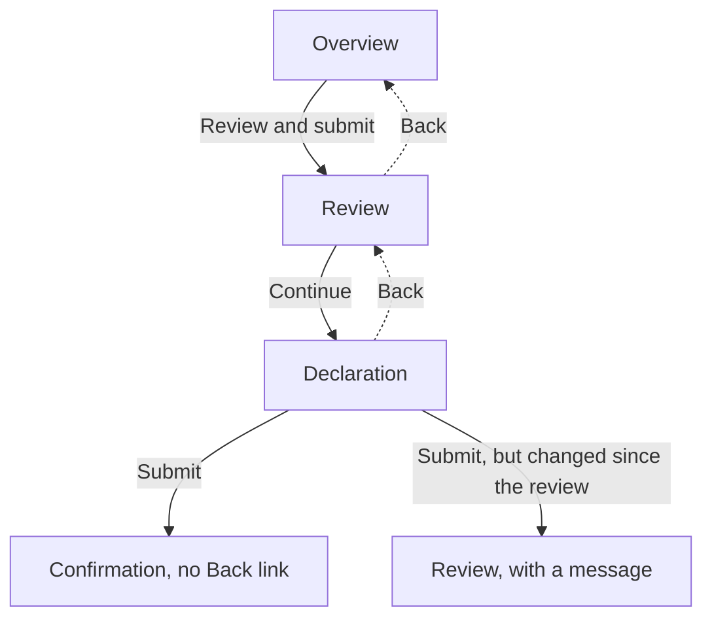

| Step | What happens | Status | Code |
|---|---|---|---|
| Review and submit on Overview | Opens the review, complete or not | On main | `features/hub/controller.js:128` |
| Continue with things missing | Refused; the review names each one | On main | `declaration/controller.js:89-97` |
| Declaration opened directly | Sent to the review | On main | `declaration/controller.js:89` |
| Submit | Confirmation, or the review with a message if the notification changed since it was shown | On main | `declaration/controller.js:95-97, 145` |
| Back from a draft's review | Overview. The spec says the notification list, planned in the templates theme's draft review row | Later theme | `check-answers/controller.js:134`; spec REQ-CYA-003-A |

## When you view a submitted notification

View opens the read-only notification, with Copy as new and Delete. Its Back link opens Overview on `main`; the spec and the prototype say the dashboard.

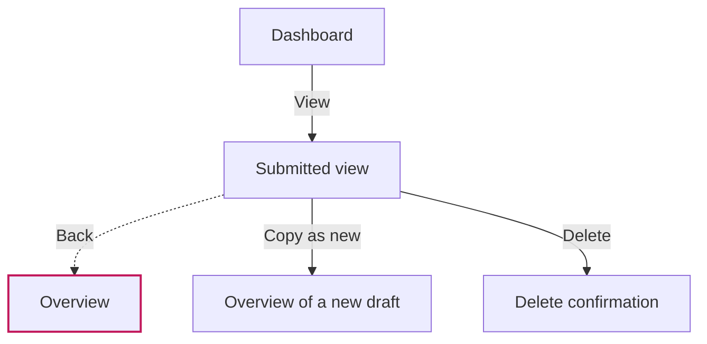

| Step | What happens | Status | Code |
|---|---|---|---|
| View on the dashboard | Opens the review page, read only | On main | `dashboard/view-model/row/actions.js:30-33` |
| Back | Overview. The spec (REQ-CYA-003-B) and the prototype say the dashboard, and no row plans the change | Differs | `check-answers/controller.js:134` |
| Amend | Not offered on this page; the prototype offers it here | Prototype | prototype `app/routes.js:6497` |

## When you amend a submitted notification

Amend on the dashboard opens Overview with the status Amend. Since the amend fix merged, this works for any submitted notification, not only ones opened in this browser session.

On main today, since the amend fix:

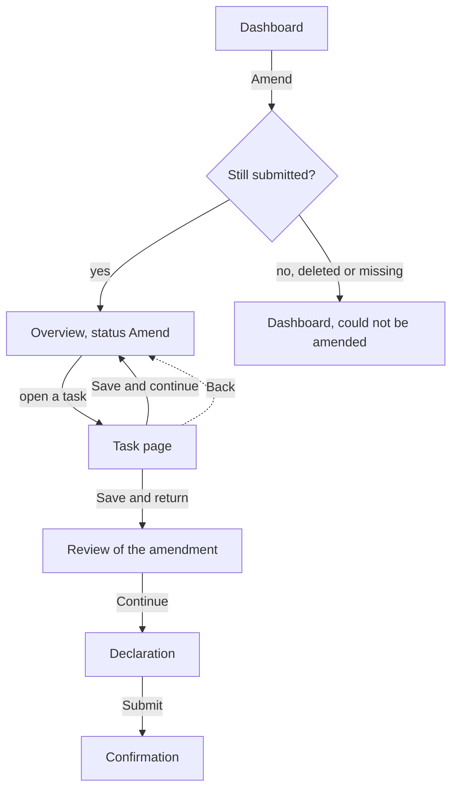

Before the amend fix:

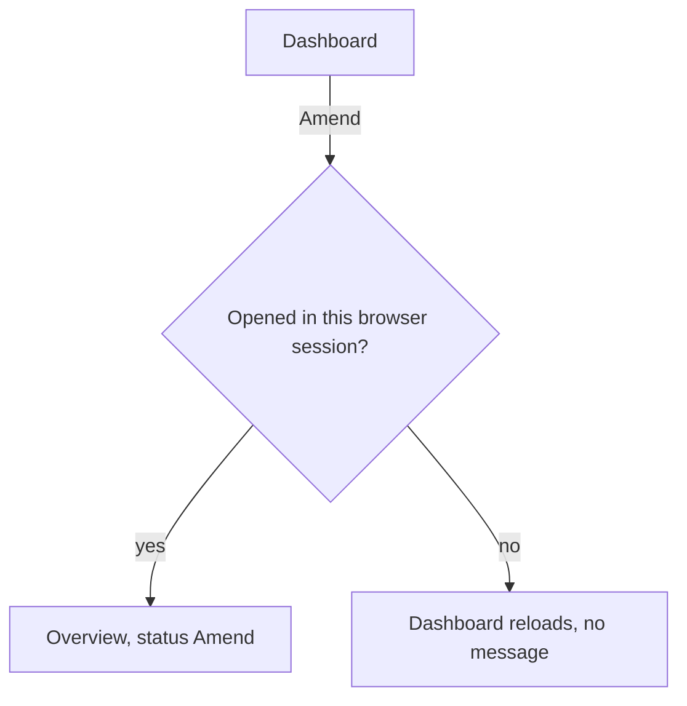

Prototype:

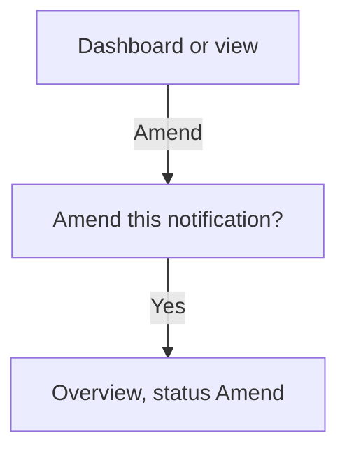

| Step | What happens | Status | Code |
|---|---|---|---|
| Amend on the dashboard | Loads the notification, adds it to this session, asks the backend to start the amendment, then opens Overview | On main | `features/dashboard/controller.js:114-119`, `engine/journey.js:161-187` |
| Amend on a deleted or missing notification | Dashboard with a message that it could not be amended | On main | `features/dashboard/controller.js:117` |
| Before the amend fix | The dashboard reloaded with no message unless this browser session had opened the notification | Before | `engine/journey.js` at d1dc8d74^ |
| A page during an amendment | Save and return goes to the review; Save and continue goes on as usual, so to Overview; Save and return to overview | On main | `shared/save-actions.njk`, `shared/amend-form-actions.js` |
| Prototype | Asks "Amend this notification?" first, and offers Amend on the view page. Main does neither | Prototype | prototype `app/routes.js:6497` |

## When you cancel an amendment

Cancel amend is in the status bar on every page of an amendment and on the dashboard. It asks first, then restores the submitted version.

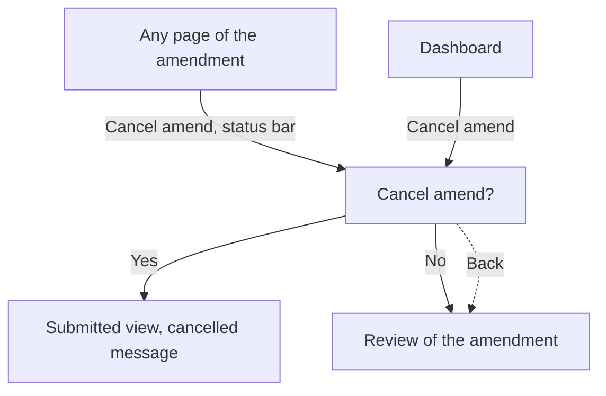

| Step | What happens | Code |
|---|---|---|
| Cancel amend | Confirmation page, with no Cancel amend in its own status bar | `cancel-amend/controller.js:26-38` |
| Yes | Restores the submitted version and shows it with a "cancelled" message | `cancel-amend/controller.js:49-65` |
| Not being amended any more | Goes to the submitted view, or the dashboard | `cancel-amend/controller.js:22-25` |

## When you copy or delete a notification

Copy as new makes a new draft and opens its Overview, with no opening run. Delete asks first, then returns to the dashboard.

```mermaid
flowchart TD
  A["Dashboard"] -->|"Copy as new"| N["Overview of the new draft"]
  V["Submitted view"] -->|"Copy as new"| N
```

```mermaid
flowchart TD
  A["Dashboard"] -->|"Delete"| DC["Delete this notification?"]
  DC -->|"Yes"| A2["Dashboard, deleted message"]
  DC -.->|"Back"| A
```

| Step | What happens | Status | Code |
|---|---|---|---|
| Copy as new | New draft at Overview, original unchanged. Works for any notification since the amend fix | On main | `notification-actions/controller.js:23-45`, `engine/journey.js:196-210` |
| Copy as new, before the amend fix | Same silent dashboard reload as Amend for notifications not opened in this session | Before | `engine/journey.js` at d1dc8d74^ |
| Delete | Confirmation, then the dashboard with a "deleted" message | On main | `delete-notification/controller.js:42-58` |

## When a page does not apply, or you link straight to one

Pages that do not apply are skipped or send you on. A link straight into a notification this session did not start, with nothing saved, goes to its first page.

```mermaid
flowchart LR
  F["Identification details, no animal to identify"] -->|"skipped"| G["The next page"]
  E["Commodity details, no commodity yet"] -->|"redirect"| C["What are you importing?"]
  DEC["Declaration, opened directly"] -->|"redirect"| R["Review"]
```

```mermaid
flowchart TD
  L["Link to a later page"] --> Q{"Started in this session, or anything saved?"}
  Q -->|"yes"| P["That page"]
  Q -->|"no"| B["Origin of the import"]
  B -->|"Save and continue"| OV["Overview, no run"]
```

| Case | What happens | Status | Code |
|---|---|---|---|
| Identification details when no animal needs identifying | Skipped, on GET and POST | On main | `animal-identification.controller.js:79-91` |
| Commodity details with no commodity | Sent to What are you importing? | On main | `consignment-details.controller.js:74` |
| Declaration opened directly | Sent to the review | On main | `declaration/controller.js:89` |
| A link to a later page, not started in this session and nothing saved | Sent to Origin of the import; saving it goes to Overview, not into the run | On main | `flow/entry-guard.js:48-60` |
| Transit countries when the transport is not Rail or Road | Still opens if linked to directly. A redirect is planned in the arrival and transit theme | Later theme | `transit-countries.controller.js` (no guard) |

## When you create a high-risk plants notification

Plants follows the same rules in its own page order. Back mid-run opens Overview and ends the run today; the same design snagging row fixes plants too. The amend fix is in plants as well.

```mermaid
flowchart TD
  A["Dashboard"] -->|"Start"| CT["Commodity type"]
  CT -->|"Save and continue"| CM["Commodities"]
  CM --> OR["Origin"]
  OR --> AS["Arrival status"]
  AS --> AD["Arrival details, part 2"]
```

```mermaid
flowchart TD
  AD["Arrival details"] --> PD["Place of destination"]
  PD --> CO["Consignor"]
  CO --> IN["Identification numbers"]
  IN --> CC["Contact address"]
  CC --> R["Review"]
```

Back today:

```mermaid
flowchart TD
  P["Commodities, Arrival status, Arrival details, Identification numbers"] -.->|"Back"| OV["Overview: the run ends"]
  OV -.->|"Back"| A["Dashboard"]
  classDef differs stroke:#c2185b,stroke-width:2px
  class OV differs
```

Back once design snagging lands:

```mermaid
flowchart RL
  CM["Commodities"] -.-> CT["Commodity type"]
  AS["Arrival status"] -.-> OR["Origin"]
  AD["Arrival details"] -.-> AS
  IN["Identification numbers"] -.-> CO["Consignor"]
```

| Point | Plants on main | Animals on main | Code |
|---|---|---|---|
| Run order | Commodity type, Commodities, Origin, Arrival status, Arrival details, Place of destination, Consignor, Identification numbers, Contact address, Review | Origin first, then the commodity pages | `plants flow/run.js:28-48` |
| Back from run pages | Overview, which ends the run. Planned: the page before it | Same today, same plan | `plants arrival-status/controller.js:65`, `arrival-details:130`, `identification-numbers:50`, `commodities/list:61` |
| First pages | Commodity type and Origin: Back to the dashboard if nothing is saved, otherwise Overview | Origin only | `plants commodity-type/controller.js:66-69` |
| Overview Back link | Has one, to the dashboard | None, by the spec | `plants hub/controller.js:144` |
| Amend and Copy as new | Fixed, as in animals | Fixed | `plants features/dashboard/controller.js:103-108` (#112) |

## Differences found that no design snagging row covers

| Difference | Where it sits |
|---|---|
| A submitted notification's view has Back to Overview; the spec (REQ-CYA-003-B) and the prototype say the dashboard | No row plans it |
| A draft's review has Back to Overview; the spec says the notification list | The draft review row in the templates theme |
| Contact address Back goes to Overview; the prototype goes to Roles and addresses | The spec keeps Overview, so not a defect |
| Identification details Back goes to Overview; the prototype goes to Commodity details | The spec keeps Overview, so not a defect |
| Transit countries opens when it does not apply | The transit countries row in the arrival and transit theme |
